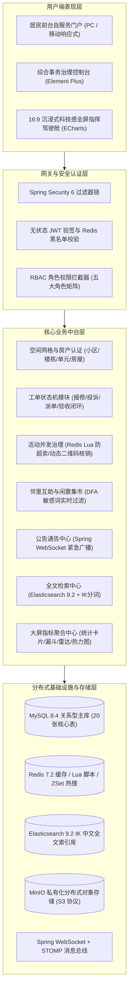
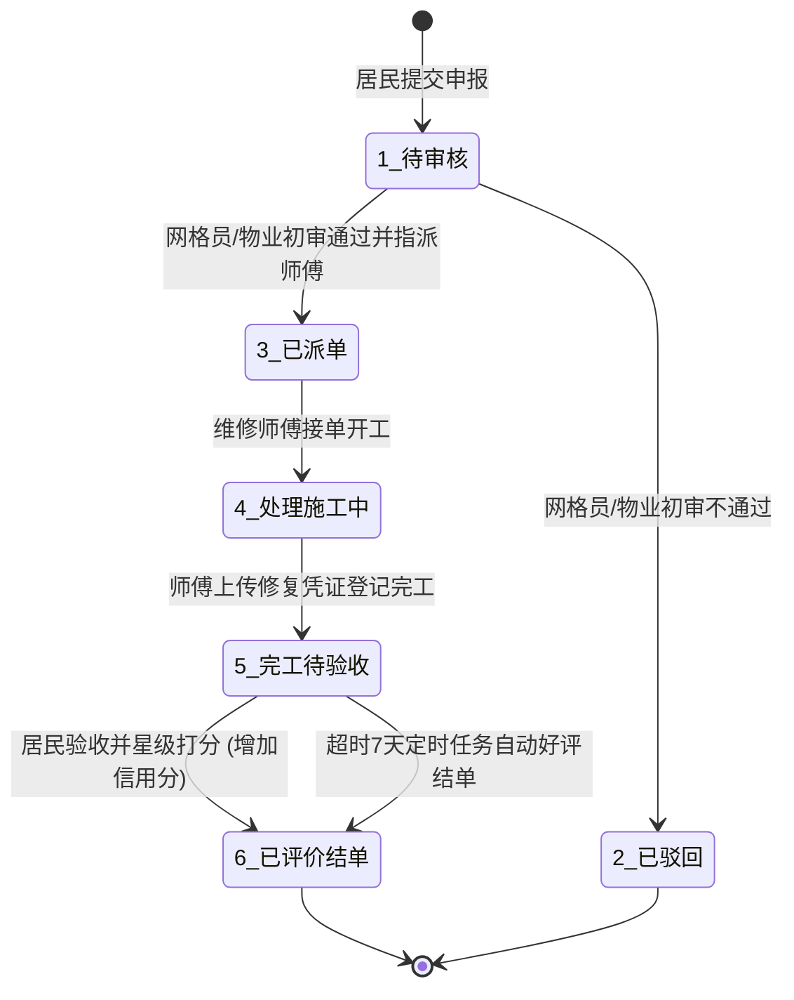
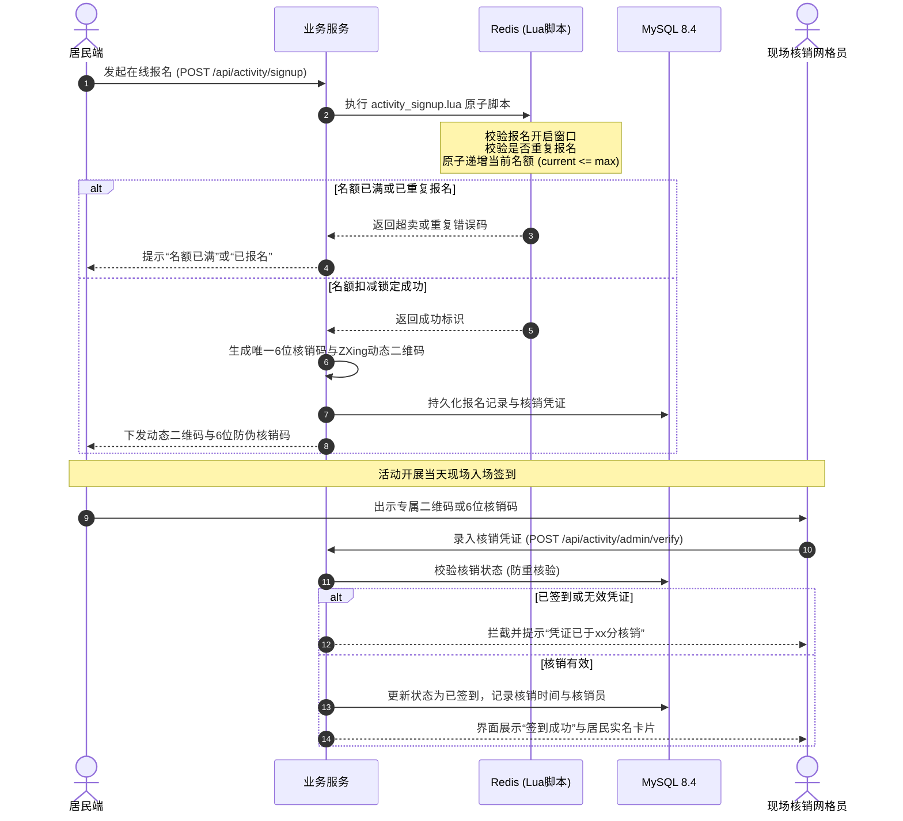
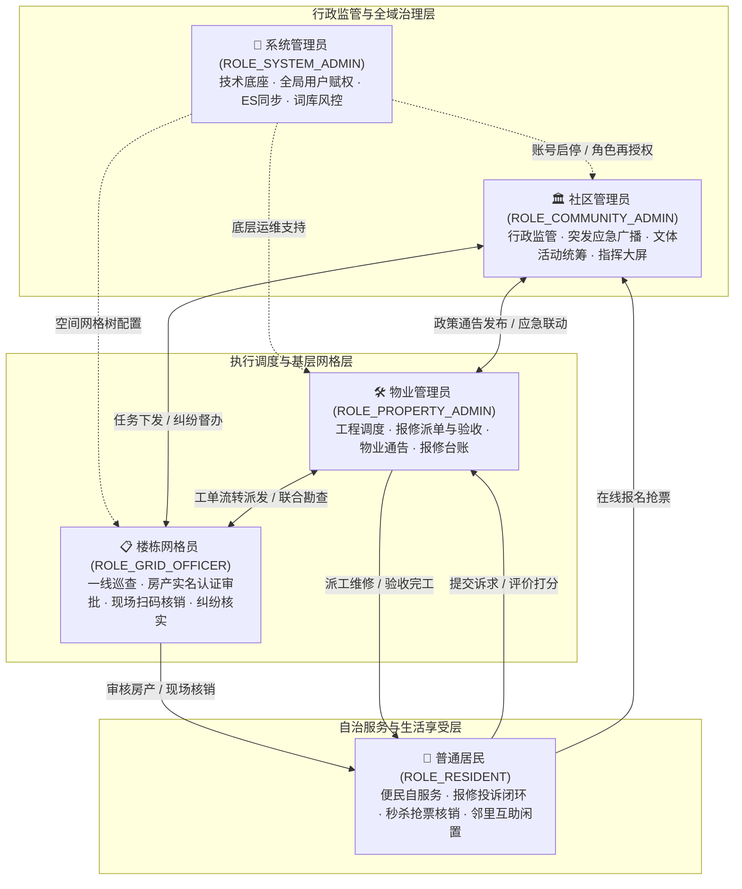
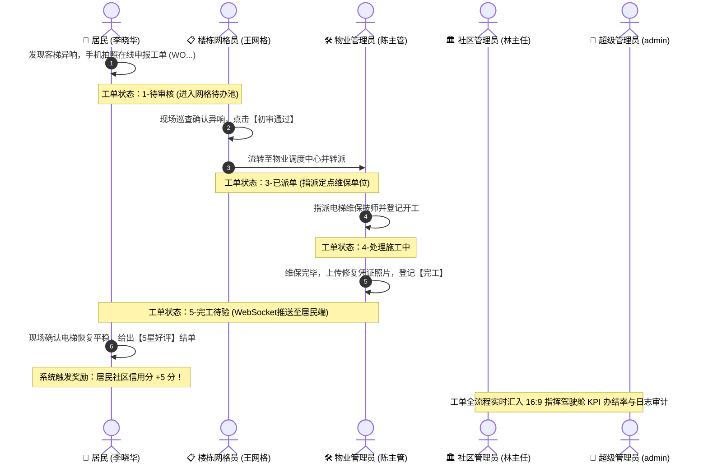

# 基于 SpringBoot 的社区综合事务管理系统 (后端服务)

> **本科毕业设计选题**：《基于SpringBoot的社区综合事务管理系统的设计与实现》  
> **核心定位**：整合社区公告、通知、报修、投诉建议、文体活动报名、邻里互助、二手闲置、空间网格与物业反馈的全功能一站式数字治理中台。

---

## 一、 系统架构设计

系统采用分层领域驱动架构设计，保障高内聚、低耦合与高可用：



---

## 二、 核心技术栈清单

| 分层维度 | 选型组件 / 框架 | 版本要求 | 选型考量与技术亮点 |
|---|---|---|---|
| **核心框架** | Spring Boot | 3.4.12 | 采用 Spring Boot 3 系列最新稳定版，全面拥抱原生虚拟线程与现代化配置 |
| **开发语言** | Java (JDK) | 21 LTS | 利用现代化模式匹配、Record、Text Blocks 以及高并发吞吐特性 |
| **持久层框架** | MyBatis-Plus | 3.5.15 | 简化 CRUD，支持 Lambda 强类型查询、分页插件与通用元数据注入 |
| **连接池** | HikariCP | 5.1.0 | 极致轻量与高吞吐的数据库连接池 |
| **认证与安全** | Spring Security + JJWT | 6.x / 0.12.5 | 基于无状态 JWT 实现会话保持，结合 Redis 维护黑名单保障即时吊销 |
| **并发治理** | Redis Lua 脚本 | 7.2 Alpine | 活动报名时原子扣减库存与名额防超卖，保障高并发下的超卖防御 |
| **全文检索** | Elasticsearch + IK | 9.2.0 | 对通知公告、闲置物品、互助求助进行分词索引与高亮搜索 |
| **私有化存储** | MinIO Object Storage | Latest (S3) | 支持工单报修照片、完工凭证、活动海报与房产认证原件的本地化持久存储 |
| **实时推送** | Spring WebSocket + STOMP | 6.2.x | 应急突发通告全区即时广播、工单流转节点实时派发到户 |
| **内容风控** | DFA 前缀树算法 | 自研 | 针对邻里互动求助与集市发帖内容，毫秒级扫描拦截涉黄涉暴违规敏感词 |
| **报表导出** | EasyExcel | 3.3.4 | 支撑千万级报修工单台账与活动居民花名册的无内存溢出极速导出 |
| **API 文档** | Knife4j (OpenAPI 3) | 4.5.0 | 自动生成标准化交互式 Swagger 接口文档，便于毕设前后端协同联调 |

---

## 三、 核心业务时序与状态流转

### 1. 报修与投诉工单状态机 (Work Order State Machine)


### 2. 活动原子报名与动态二维码现场核销


---

## 四、 数据库核心模型表说明

系统包含 20 张核心业务与权限表（全量外键索引与逻辑约束均已固化）：

| 表名 | 模块类别 | 核心功能与字段职责 |
|---|---|---|
| `sys_user` | 权限中心 | 用户主表，包含密码哈希、真实姓名、手机号、信用分、账号状态 |
| `sys_role` | 权限中心 | RBAC 角色字典 (系统管理员、社区管理员、物业管理员、网格员、居民) |
| `sys_user_role` | 权限中心 | 用户与角色多对多关联映射表 |
| `biz_community` | 空间网格 | 小区基础信息、经纬度地理坐标、联系方式 |
| `biz_building` | 空间网格 | 楼栋台账表 (楼栋编号、总层数、总单元数、绑定网格长) |
| `biz_unit` | 空间网格 | 单元字典表 (单元号、是否有电梯) |
| `biz_house` | 空间网格 | 房屋户室表 (门牌号、建筑面积、户型、居住状态) |
| `biz_resident_house` | 空间网格 | 居民房产认证表 (居住身份：业主/家属/租客，佐证材料，审核流) |
| `biz_work_order` | 工单中心 | 报修与投诉工单主表 (状态机：待审/驳回/派单/施工/完工/结单) |
| `biz_order_log` | 工单中心 | 工单全生命周期流转轨迹日志表 (记录操作人、前后状态、流转凭证) |
| `biz_activity` | 社区活动 | 文体公益活动信息 (报名起止时间、名额上限、当前人数、状态) |
| `biz_activity_signup` | 社区活动 | 活动报名核销凭据表 (6位防伪核销码、二维码 Base64、签到时间) |
| `biz_market_post` | 邻里互助 | 闲置转让、借物、拼车、求助主表 (价格、交付方式、流转状态) |
| `biz_post_comment` | 邻里互助 | 帖子楼中楼留言互动表 (支持二级回复、敏感词自动过滤) |
| `biz_post_favorite` | 邻里互助 | 居民对闲置和互助帖的收藏关系表 |
| `biz_sensitive_word` | 内容风控 | DFA 算法敏感词过滤库 (分类：违禁、诈骗、低俗、政治，匹配规则) |
| `biz_report` | 内容风控 | 违规纠纷举报处理表 (受理类型、举报依据、核查处置说明) |
| `sys_notice` | 消息通告 | 社区公告表 (政策宣传、便民提示、物业通知、突发应急广播) |
| `sys_user_notice` | 消息通告 | 居民个人站内信箱表 (已读未读红点标记、业务跳转ID) |
| `sys_operation_log` | 系统审计 | 管理员及工作人员关键操作审计日志 (耗时统计、参数快照) |

---

## 五、 五大人员角色定位、权限边界与职责差异化对比 (RBAC Matrix)

系统严格基于 **RBAC (Role-Based Access Control)** 模型进行细粒度权限控制，针对社区数字化治理中“管、办、评、巡、居”五大核心诉求，设计了分层互补、权责分明的五大用户角色矩阵：



### 1. 五大角色核心区别全维度对比矩阵

| 比较维度 | 👑 系统超级管理员 | 🏛️ 社区管理员 (管委会) | 🛠️ 物业管理员 (服务处) | 📋 楼栋网格员 (楼栋长) | 🏡 普通居民 (常住住户) |
|---|---|---|---|---|---|
| **角色编码** | `ROLE_SYSTEM_ADMIN` | `ROLE_COMMUNITY_ADMIN` | `ROLE_PROPERTY_ADMIN` | `ROLE_GRID_OFFICER` | `ROLE_RESIDENT` |
| **核心定位** | 系统技术底座与全局运维总掌舵人 | 社区居委会行政统筹与宏观自治决策者 | 物业工程部设备维保与日常维修调度者 | 基层毛细血管触角、面对面网格一线联络员 | 社区服务享受者与基层共治主人翁 |
| **系统访问界面** | 中后台控制台 + 全屏指挥大屏 + 居民门户 | 中后台控制台 + 全屏指挥大屏 + 居民门户 | 中后台控制台 + 居民门户 | 中后台控制台 + 居民门户 | 居民便民自服务门户 + 个人中心 |
| **空间管控范围** | 全局所有小区、全量楼宇、单元与房产树 | 整个小区辖区内所有网格楼宇与公共事务 | 小区公区工程设施、各楼栋报修承修区域 | 所管辖绑定的具体楼栋与责任单元网格 | 仅本人已实名认证绑定的门牌房屋 |
| **工单流转职能** | 拥有工单全局数据查看与台账审计权限 | 宏观监督工单处理时效与满意度走势 | 初审工单、指派师傅施工、完工验收凭证 | 现场实地勘查微报修、楼道公区故障一线初审 | 在线申报、跟踪时间轴、完工验收五星评价 |
| **房产认证职能** | 空间架构树（小区/楼栋/房屋）配置建档 | 调阅居民实名档案、监督认证合规性 | 查阅住户档案用于水电维修与入户核实 | **在线初审并比对购房合同/租约原件完成认证** | 在线提交产证/租房合同凭据认领绑定房屋 |
| **文体活动职能** | 活动底层名额并发防超卖架构与数据维护 | **发起并组织活动、把控名额容量、导出花名册** | 配合协调活动场地水电与场地秩序 | **活动开展当天在入口台进行现场扫码/动态码核销** | 浏览活动、高并发抢票、出示动态核销凭证 |
| **内容风控职能** | **增删维护 DFA 敏感词库，热重构前缀树** | 监督社区舆论动态、调解重大矛盾纠纷 | 查阅物业维保相关纠纷与反馈 | 走访现场核查违规举报真实性，给予处置意见 | 发布闲置与求助帖、违禁举报、互动留言 |
| **通告广播职能** | 监控 STOMP 消息推送服务通道连通性 | **发布官方政策、触发全区突发应急广播(弹窗)** | **发布二次供水清洗停水、电梯维保停运等通告** | 协助向楼栋不便上网老人传达关键通告 | 实时接收突发应急广播弹窗强提醒与站内信 |
| **用户与权限管控**| **查询全量用户、启停账号、动态重分配角色** | 具备用户中心同级查看权、督导账号状态 | 无权变更系统用户账号与权限字典 | 无权变更系统用户账号与权限字典 | 仅可修改个人资料（昵称/手机/密码） |
| **信用积分体系** | 查看与审计全员互助积分，人工纠偏校准 | 监督信用积分榜单，纳入文明住户评选 | 维修师傅完工质量与业主好评挂钩考评 | 走访核实恶性违规行为，建议扣除信用分 | **守信履约积累积分（如完工好评自动奖励5分）** |
| **预置体验账号** | `admin` / `123456` | `community_admin` / `123456` | `property_admin` / `123456` | `grid_officer` / `123456` | `resident` / `123456` |

---

### 2. 五大人员角色深度职责与权限边界剖析

#### 👑 角色一：系统超级管理员 (ROLE_SYSTEM_ADMIN)
- **业务定位**：掌控系统全局基础元数据、安全风控底座与全局运维。
- **核心职责清单**：
  1. **全局用户生命周期管控**：进入 `用户中心与RBAC赋权` 模块，对系统全量注册用户进行状态启用/停用冻结，并在五大角色间进行动态赋权再分配；
  2. **全文检索引擎全局运维**：一键触发 `/api/search/admin/sync-all`，从 MySQL 8.4 重新提取公告、活动、集市数据并重建 Elasticsearch 9.2 全文索引库；
  3. **内容安全风控底座维护**：维护 `biz_sensitive_word` 词库，增删低俗、违禁、欺诈等关键词，实时驱动系统热重载内存 DFA Trie 树；
  4. **全区空间网格树状初始化**：配置小区基本信息、添加楼栋台账（绑定楼栋长/网格员）、划定单元及房屋户室数据。
- **代码级权限特征**：拥有 Spring Security `@PreAuthorize` 的最高通行权，可调用 `/api/user/admin/**` 及 `/api/search/admin/**`。

#### 🏛️ 角色二：社区管委会管理员 (ROLE_COMMUNITY_ADMIN)
- **业务定位**：代表社区居委会/党群服务中心，主导公共事务行政统筹、政务发布与重大态势监督。
- **核心职责清单**：
  1. **政务通告与全域应急强提醒**：发布政策法规通报；遭遇台风汛情、公共卫生突发事件时，发布类型为 `4 (突发应急)` 的广播，瞬间通过 WebSocket + STOMP 穿透推送到所有在线居民端全屏告警；
  2. **文体公益活动全案策划**：在后台发布活动封面、排期、名额上限；基于 EasyExcel 导出报名居民花名册 Excel 用于物料准备与安保测算；
  3. **16:9 沉浸式驾驶舱全息掌控**：常态化挂载全屏科技感大屏，实时监测入住率、工单流转漏斗、五维治理活力雷达图与报修热力排行榜；
  4. **行政纠纷协调裁决**：监督居民举报工单处置进度，处理影响社区和谐的疑难矛盾纠纷。
- **代码级权限特征**：拥有公告发布 (`/api/notice/admin/publish`)、活动统筹管理与大屏指标聚合接口访问权。

#### 🛠️ 角色三：物业调度管理员 (ROLE_PROPERTY_ADMIN)
- **业务定位**：代表小区物业服务中心与工程部，专注设施巡检、报修调度与民生维保。
- **核心职责清单**：
  1. **报修与投诉工单调度枢纽**：初审居民线上申报的报修故障（如电梯异响、管道漏水）；指派指定维修师傅（水电工、维保单位），登记派单时间与师傅联络方式；
  2. **施工跟进与完工核验闭环**：监控维修师傅接单施工进度，审核师傅上传的修复验收凭证照片；
  3. **物业工程大数据台账导出**：依托 EasyExcel 一键将工单报修记录流式导出为 Excel 电子表格，供物业公司留档、成本核算与工程考核；
  4. **日常物业通告精准发布**：发布二次供水清洗消杀停水通知、电梯例行维保停运、消防车道清障通报等专项便民通告。
- **代码级权限特征**：聚焦工单状态机调度接口 (`/api/order/admin/**`) 与工单台账 Excel 导出。

#### 📋 角色四：楼栋网格员 / 楼栋长 (ROLE_GRID_OFFICER)
- **业务定位**：社区基层精细化治理的“神经末梢”，打通服务居民的“最后一百米”，兼顾线上审批与线下走访。
- **核心职责清单**：
  1. **房产认证与人口实名核验**：负责在线审核居民认领本楼栋房屋的申请，严格比对居民上传的房产证原件、购房合同或房屋租赁备案凭证，核实居住身份（业主/家属/租客）；
  2. **楼栋微报修公区故障初勘**：对居民反映的楼道灯具、单元对讲门等报修进行现场巡查核实，确认无误后通过初审并提报物业派单；
  3. **活动现场核销签到工作台**：在文体公益活动现场值守，使用电脑端或手持设备录入居民出示的 6 位动态防伪核销码（或通过扫码枪解析二维码 Base64），即时完成入场核销，防止冒领与二次使用；
  4. **邻里纠纷与违规现场核查**：接到闲置物品纠纷、飞线充电等举报后实地走访核查，提交第一手网格裁决说明。
- **代码级权限特征**：拥有房产审批 (`/api/grid/admin/house-bind/audit`)、工单初审与活动防伪核销 (`/api/activity/admin/verify`) 权限。

#### 🏡 角色五：社区常住居民 (ROLE_RESIDENT)
- **业务定位**：智慧社区平台的核心服务对象、数字生活受益者与基层治理参与者。
- **核心职责清单**：
  1. **在线认证与房产绑定**：居民在线注册后，绑定具体门牌户室并提交权属佐证材料，认证通过后获得完整社区权益；
  2. **报修与投诉一键在线申报**：上传故障现场照片、选定是否加急，提交工单后全流程在时间轴查看师傅派工与进度；修复后对服务进行 1~5 星星级评价（**评价完成系统自动奖励 5 点信用积分**）；
  3. **文体活动高并发抢票体验**：在线查看全区文体活动，在开放窗口期进行原子秒杀报名（受 Redis Lua 脚本保护防超卖），报名成功自动生成唯一 6 位核销码与动态二维码存入凭据卡包；
  4. **邻里互助与闲置低碳循环**：在邻里集市发布二手闲置、求助借物（如电锤冲击钻借用、绿植赠送）；支持楼中楼留言互动、点赞与收藏（内容自动经过 DFA 敏感词毫秒级过滤）；
  5. **消息即时接收与信箱互动**：全天候接收全区突发应急广播弹窗，个人中心查阅工单进展与活动凭证站内信。
- **代码级权限特征**：面向前台便民 API (`/api/order/submit`, `/api/activity/signup`, `/api/market/publish`, `/api/grid/house-bind`)。

---

### 3. 典型业务跨角色协同流转时序图 (工单全生命周期为例)



---

## 六、 本地环境搭建与服务启动

### 1. 启动中间件基础设施 (Docker Compose)
项目依托统一的中间件容器栈，在工作区执行：
```bash
cd /Users/li/Code/dev-databases
./start.sh
# 或使用标准命令
docker compose up -d
```
中间件默认连接信息：
- **MySQL 8.4**：端口 `3306`，账号 `root`，密码 `123456`，数据库 `community_affairs`
- **Redis 7.2**：端口 `6379`，密码 `123456`
- **MinIO S3**：API 端口 `9000`，控制台 `9001`，账号 `minioadmin`，密码 `minioadmin123`
- **Elasticsearch 9.2**：端口 `9200`，集成 IK 中文分词插件

### 2. 初始化数据库表结构与预置数据
执行 `/Users/li/Code/dev-databases/init/mysql/community_affairs.sql` 脚本，完成 20 张核心数据表与预置初始数据的导入。

### 3. 编译并启动后端服务
```bash
cd /Users/li/Code/Java/JavaProjects/community-affairs
# 依赖编译检查
./mvnw clean compile -DskipTests

# 启动 Spring Boot 服务
./mvnw spring-boot:run
```
服务将在本地 `http://localhost:8082` 端口就绪：
- **Knife4j 交互式接口文档**：`http://localhost:8082/doc.html`
- **OpenAPI 3 JSON 描述**：`http://localhost:8082/v3/api-docs`

---

## 七、 核心 RESTful API 清单概览

| 模块名称 | 接口路径 | 请求方式 | 接口功能与业务说明 |
|---|---|---|---|
| **认证授权** | `/api/auth/login` | POST | 五大角色统一认证登录，返回 JWT 与基础档案 |
| | `/api/auth/register` | POST | 普通新居民在线实名注册并分配初始信用分 |
| | `/api/auth/current` | GET | 获取当前登录用户的上下文及已认证绑定的房产清单 |
| **空间网格** | `/api/grid/buildings` | GET | 树状级联获取楼栋列表及所属网格员 |
| | `/api/grid/houses/{unitId}` | GET | 获取指定单元下的门牌号台账与常住状态 |
| | `/api/grid/house-bind` | POST | 居民在线提交房产认证申请（附带购房/租房合同凭证） |
| | `/api/grid/admin/house-bind/audit` | PUT | 网格员/物业审批房产认领申请 |
| **工单调度** | `/api/order/submit` | POST | 居民在线申报报修或投诉工单（支持加急与照片凭证） |
| | `/api/order/my-list` | GET | 居民查询本人的历史申报工单及跟踪状态 |
| | `/api/order/admin/audit` | PUT | 初审工单：审核通过并指派师傅，或驳回处置 |
| | `/api/order/admin/complete` | PUT | 维修人员登记完工并上传修复验收照片 |
| | `/api/order/evaluate` | POST | 居民五星评价结单，自动增加个人信用分 |
| | `/api/order/admin/export` | GET | 导出全区工单台账 Excel 电子表格 |
| **活动高并发** | `/api/activity/list` | GET | 公开/居民浏览可参与的文体公益活动 |
| | `/api/activity/signup` | POST | 居民在线报名（基于 Redis Lua 脚本原子防超卖） |
| | `/api/activity/admin/verify` | POST | 现场网格员扫码或输入6位动态码完成核销入场 |
| | `/api/activity/admin/export/{id}` | GET | 导出指定活动已报名居民花名册 Excel |
| **邻里集市** | `/api/market/publish` | POST | 居民发布闲置与求助（自动触发 DFA 敏感词过滤） |
| | `/api/market/comment` | POST | 邻里发表互动评论（自动拦截涉敏违规内容） |
| | `/api/market/like/{id}` | POST | 帖子点赞与取消点赞切换 |
| | `/api/market/favorite/{id}` | POST | 帖子收藏夹功能 |
| **内容风控** | `/api/moderation/report/submit` | POST | 居民提交违规或矛盾纠纷举报工单 |
| | `/api/moderation/admin/report/handle` | PUT | 网格中心裁决举报：确认违规一键下架并扣分 |
| | `/api/moderation/admin/word/save` | POST | 维护敏感词库，实时同步重构内存 DFA 前缀树 |
| **大屏驾驶舱** | `/api/admin/dashboard/metrics` | GET | 工作台核心指标统计卡片数据 |
| | `/api/admin/screen/data` | GET | 16:9 全屏指挥驾驶舱综合治理可视化聚合数据包 |
| **全文检索** | `/api/search` | GET | 基于 Elasticsearch 9.2 + IK 的全局多维全文检索 |
| | `/api/search/hot` | GET | 获取全网热搜词榜单（基于 Redis ZSet 权重排序） |
| **通用文件** | `/api/common/upload` | POST | 多媒体文件上传至 MinIO 私有化对象存储桶 |
