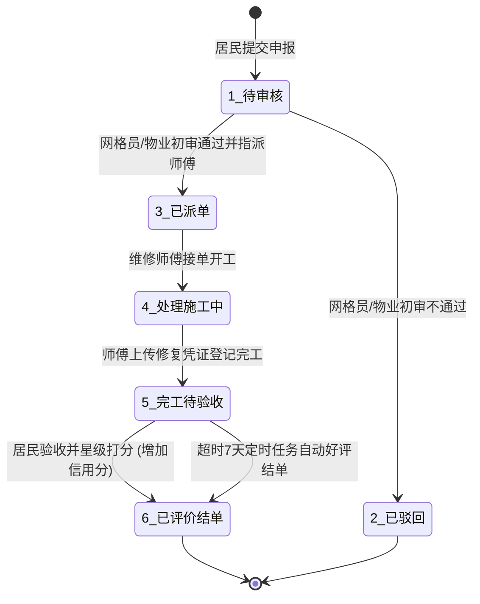
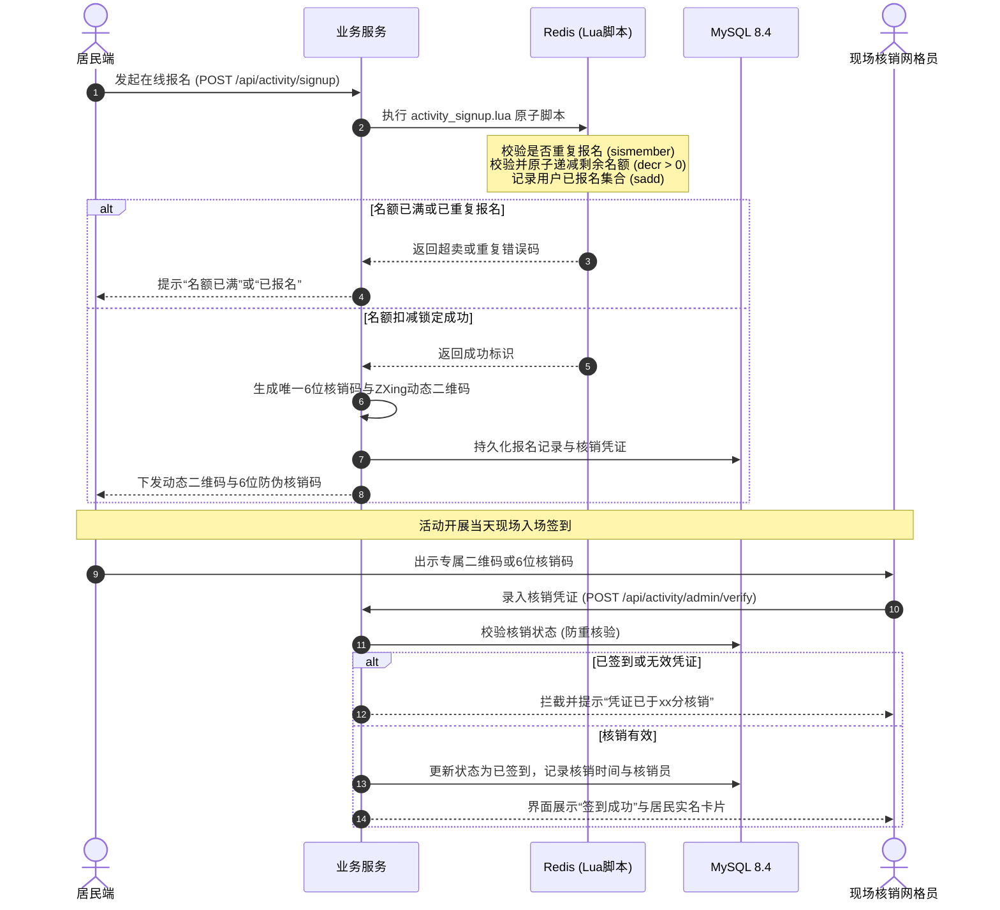
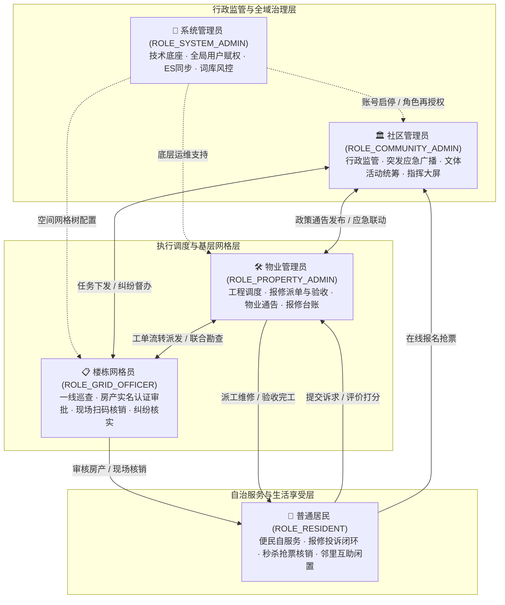
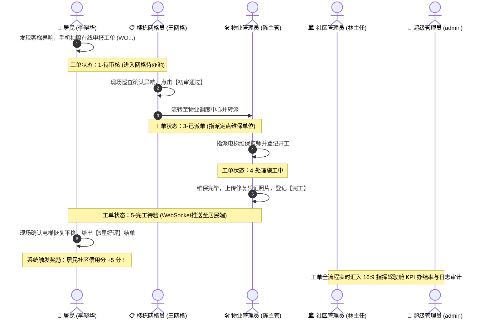

# 基于 SpringBoot 的社区综合事务管理系统 (后端服务)

> **本科毕业设计选题**：《基于SpringBoot的社区综合事务管理系统的设计与实现》  
> **核心定位**：整合社区公告、通知、报修、投诉建议、文体活动报名、邻里互助、二手闲置、空间网格与物业反馈的全功能一站式数字治理中台。  
> **前端配套工程**：[community-affairs-vue](https://github.com/e69d8e/community-affairs-vue)（Vue 3 + Vite 6 + TypeScript + Element Plus + Pinia + ECharts）

---

## 一、 系统架构设计

系统采用分层领域驱动架构设计，保障高内聚、低耦合与高可用：

```mermaid
flowchart TD
    subgraph ClientLayer ["用户端表现层"]
        ResidentUI["居民前台自服务门户 (PC / 移动响应式)"]
        AdminUI["综合事务治理控制台 (Element Plus)"]
        CockpitUI["16:9 沉浸式科技感全屏指挥驾驶舱 (ECharts)"]
    end

    subgraph GatewaySecurity ["网关与安全认证层"]
        Security["Spring Security 6 过滤器链"]
        JWT["无状态 JWT 验签与 Redis 黑名单校验"]
        RBAC["RBAC 角色权限拦截器 (五大角色矩阵)"]
    end

    subgraph BusinessService ["核心业务中台层"]
        GridService["空间网格与房产认证 (小区/楼栋/单元/房屋)"]
        WorkOrderService["工单状态机模块 (报修/投诉/派单/验收闭环)"]
        ActivityService["活动并发治理 (Redis Lua 防超卖/动态二维码核销)"]
        MarketService["邻里互助与闲置集市 (DFA 敏感词实时过滤)"]
        ChatService["邻里私信沟通服务 (点对点私信/会话追踪/未读提醒)"]
        NoticeService["公告通告中心 (Spring WebSocket 紧急广播)"]
        SearchService["全文检索中心 (Elasticsearch 9.2 + IK分词)"]
        DashboardService["大屏指标聚合中心 (统计卡片/漏斗/雷达/热力图)"]
    end

    subgraph InfrastructureLayer ["分布式基础设施与存储层"]
        MySQL[("MySQL 8.4 关系型主库 (23张核心表)")]
        Redis[("Redis 7.2 缓存 / Lua 脚本 / ZSet 热搜")]
        ES[("Elasticsearch 9.2 IK 中文全文索引库")]
        MinIO[("MinIO 私有化分布式对象存储 (S3 协议)")]
        STOMP["Spring WebSocket + STOMP 消息总线"]
    end

    ClientLayer --> GatewaySecurity
    GatewaySecurity --> BusinessService
    BusinessService --> InfrastructureLayer
```



---

## 二、 核心技术栈清单

| 分层维度 | 选型组件 / 框架 | 版本要求 | 选型考量与技术亮点 |
|---|---|---|---|
| **核心框架** | Spring Boot | 3.4.12 | 采用 Spring Boot 3 系列最新稳定版，全面拥抱原生虚拟线程与现代化配置 |
| **开发语言** | Java (JDK) | 21 LTS | 利用现代化模式匹配、Record、Text Blocks 以及高并发吞吐特性 |
| **持久层框架** | MyBatis-Plus | 3.5.15 | 简化 CRUD，支持 Lambda 强类型查询、分页插件与通用元数据注入 |
| **连接池** | HikariCP | 5.1.0 | 极致轻量与高吞吐的数据库连接池 |
| **认证与安全** | Spring Security + JJWT | 6.x / 0.12.5 | 基于无状态 JWT 实现会话保持，结合 Redis 维护黑名单保障即时吊销 |
| **并发治理** | Redis Lua 脚本 | 7.2 Alpine | 活动报名时原子扣减库存与名额防超卖，保障高并发下的超卖防御 |
| **全文检索** | Elasticsearch + IK | 9.2.0 | 对通知公告、闲置物品、互助求助进行分词索引与高亮搜索 |
| **私有化存储** | MinIO Object Storage | alpine/minio:RELEASE.2025-10-15T17-29-55Z | 支持工单报修照片、完工凭证、活动海报与房产认证原件的本地化持久存储 |
| **实时推送** | Spring WebSocket + STOMP | 6.2.x | 应急突发通告全区即时广播、工单流转节点实时派发到户 |
| **内容风控** | DFA 前缀树算法 | 自研 | 针对邻里互动求助与集市发帖内容，毫秒级扫描拦截涉黄涉暴违规敏感词 |
| **报表导出** | EasyExcel | 3.3.4 | 支撑千万级报修工单台账与活动居民花名册的无内存溢出极速导出 |
| **API 文档** | Knife4j (OpenAPI 3) | 4.6.0 | 自动生成标准化交互式 Swagger 接口文档，便于毕设前后端协同联调 |
| **大模型智能化** | LangChain4j + OpenAI 规范 | 1.0.0-beta3 | 接入 DeepSeek/通义千问等 LLM，实现社区百事通 SSE 流式问答、工单智能填报与初审分诊研判（支持离线规则降级） |

---

## 三、 核心业务时序与状态流转

### 1. 报修与投诉工单状态机 (Work Order State Machine)


### 2. 活动原子报名与动态二维码现场核销


---

## 四、 数据库核心模型表说明

系统包含 23 张核心业务与权限表（其中 21 张由 `init/mysql/community_affairs.sql` 首次初始化创建，`biz_post_like` 与 `biz_chat_message` 在应用启动时由 `DatabaseInitializer` 自动幂等建表增补，全量索引与逻辑约束均已固化）：

| 表名 | 模块类别 | 核心功能与字段职责 |
|---|---|---|
| `sys_user` | 权限中心 | 用户主表，包含密码哈希、真实姓名、手机号、信用分、账号状态、所属小区ID |
| `sys_role` | 权限中心 | RBAC 角色字典 (系统管理员、社区管理员、物业管理员、网格员、居民) |
| `sys_user_role` | 权限中心 | 用户与角色多对多关联映射表 |
| `biz_community` | 空间网格 | 小区基础信息、经纬度地理坐标、联系方式 |
| `biz_building` | 空间网格 | 楼栋台账表 (楼栋编号、总层数、总单元数、绑定网格长) |
| `biz_unit` | 空间网格 | 单元字典表 (单元号、是否有电梯) |
| `biz_house` | 空间网格 | 房屋户室表 (门牌号、建筑面积、户型、居住状态) |
| `biz_resident_house` | 空间网格 | 居民房产认证表 (居住身份：业主/家属/租客，佐证材料，审核流) |
| `biz_work_order` | 工单中心 | 报修与投诉工单主表 (状态机：待审/驳回/派单/施工/完工/结单) |
| `biz_order_log` | 工单中心 | 工单全生命周期流转轨迹日志表 (记录操作人、前后状态、流转凭证) |
| `biz_activity` | 社区活动 | 文体公益活动信息 (报名起止时间、名额上限、当前人数、状态) |
| `biz_activity_signup` | 社区活动 | 活动报名核销凭据表 (专属6位防伪核销码、128位动态签到二维码串、签到时间) |
| `biz_market_post` | 邻里互助 | 闲置转让、借物、拼车、求助主表 (价格、交付方式、流转状态) |
| `biz_post_comment` | 邻里互助 | 帖子楼中楼留言互动表 (支持二级回复、敏感词自动过滤) |
| `biz_post_like` | 邻里互助 | 帖子点赞记录表 (用户与帖子联合唯一索引 uk_user_post 防重复点赞) |
| `biz_post_favorite` | 邻里互助 | 居民对闲置和互助帖的收藏关系表 |
| `biz_chat_message` | 邻里私信 | 邻里闲置互助私信表 (会话 session_id 标识、点对点买卖沟通、已读未读状态与未读统计) |
| `biz_sensitive_word` | 内容风控 | DFA 算法敏感词过滤库 (分类：违禁、诈骗、低俗、政治，匹配规则) |
| `biz_report` | 内容风控 | 违规纠纷举报处理表 (受理类型、举报依据、所属小区、核查处置说明) |
| `sys_notice` | 消息通告 | 社区公告表 (政策宣传、便民提示、物业通知、突发应急广播) |
| `sys_user_notice` | 消息通告 | 居民个人站内信箱表 (已读未读红点标记、业务跳转ID) |
| `sys_operation_log` | 系统审计 | 管理员及工作人员关键操作审计日志 (耗时统计、参数快照) |
| `sys_file` | 基础设施 | 文件秒传登记表 (SHA-256 内容指纹去重、MinIO 对象路径、文件大小与孤儿定时清理依据) |

---

## 五、 五大人员角色定位、权限边界与职责差异化对比 (RBAC Matrix)

系统严格基于 **RBAC (Role-Based Access Control)** 模型进行细粒度权限控制，针对社区数字化治理中“管、办、评、巡、居”五大核心诉求，设计了分层互补、权责分明的五大用户角色矩阵：



### 1. 五大角色核心区别全维度对比矩阵

| 比较维度 | 👑 系统超级管理员 | 🏛️ 社区管理员 (管委会) | 🛠️ 物业管理员 (服务处) | 📋 楼栋网格员 (楼栋长) | 🏡 普通居民 (常住住户) |
|---|---|---|---|---|---|
| **角色编码** | `ROLE_SYSTEM_ADMIN` | `ROLE_COMMUNITY_ADMIN` | `ROLE_PROPERTY_ADMIN` | `ROLE_GRID_OFFICER` | `ROLE_RESIDENT` |
| **核心定位** | 系统技术底座与全局运维总掌舵人 | 社区居委会行政统筹与宏观自治决策者 | 物业工程部设备维保与日常维修调度者 | 基层毛细血管触角、面对面网格一线联络员 | 社区服务享受者与基层共治主人翁 |
| **系统访问界面** | 中后台控制台 + 全屏指挥大屏 + 居民门户 | 中后台控制台 + 全屏指挥大屏 + 居民门户 | 中后台控制台 + 居民门户 | 中后台控制台 + 居民门户 | 居民便民自服务门户 + 个人中心 |
| **空间管控范围** | 全局所有小区、全量楼宇、单元与房产树 | 整个小区辖区内所有网格楼宇与公共事务 | 小区公区工程设施、各楼栋报修承修区域 | 所管辖绑定的具体楼栋与责任单元网格（由 `biz_building.grid_officer_id` 在服务层强制数据隔离） | 仅本人已实名认证绑定的门牌房屋 |
| **工单流转职能** | 拥有工单全局数据查看与台账审计权限 | 宏观监督工单处理时效与满意度走势 | **独占派单、接单开工与完工登记**，并参与工单初审 | 现场实地勘查微报修、楼道公区故障一线初审（仅本楼栋工单可见） | 在线申报、跟踪时间轴、完工验收五星评价 |
| **房产认证职能** | 楼宇空间台账（楼栋/单元/房屋）增删改与批量建档维护 | 楼宇空间台账维护、调阅居民实名档案、监督认证合规性 | 楼宇空间台账维护（含房态更新）、查阅住户档案用于水电维修与入户核实 | **在线初审并比对购房合同/租约原件完成认证**（仅本楼栋，无结构维护权） | 在线提交产证/租房合同凭据认领绑定房屋 |
| **文体活动职能** | 活动底层名额并发防超卖架构与数据维护 | **发起并组织活动、把控名额容量、导出花名册** | 配合协调活动场地水电与场地秩序 | **活动开展当天在入口台进行现场扫码/动态码核销** | 浏览活动、高并发抢票、出示动态核销凭证 |
| **内容风控职能** | **独占增删维护 DFA 敏感词库，热重构前缀树** | 受理裁决违规举报、调解重大矛盾纠纷 | 无权受理举报工单（聚焦工程维保职责域） | 走访现场核查违规举报真实性，给予处置意见 | 发布闲置与求助帖、违禁举报、互动留言 |
| **通告广播职能** | 监控 STOMP 消息推送服务通道连通性 | **发布官方政策、触发全区突发应急广播(弹窗)** | **发布二次供水清洗停水、电梯维保停运等通告** | 协助向楼栋不便上网老人传达关键通告 | 实时接收突发应急广播弹窗强提醒与站内信 |
| **用户与权限管控**| **独占用户中心：查询全量用户、启停账号、动态重分配角色** | 无权访问用户中心（赋权属系统管理员独占职责） | 无权变更系统用户账号与权限字典 | 无权变更系统用户账号与权限字典 | 仅可修改个人资料（昵称/手机/密码） |
| **信用积分体系** | 查看与审计全员互助积分，人工纠偏校准 | 监督信用积分榜单，纳入文明住户评选 | 维修师傅完工质量与业主好评挂钩考评 | 走访核实恶性违规行为，建议扣除信用分 | **守信履约积累积分（如完工好评自动奖励5分）** |
| **预置体验账号** | `admin` / `123456` | `community_admin` / `123456` | `property_admin` / `123456` | `grid_officer` / `123456` | `resident` / `123456` |

---

### 2. 五大人员角色深度职责与权限边界剖析

#### 👑 角色一：系统超级管理员 (ROLE_SYSTEM_ADMIN)
- **业务定位**：掌控系统全局基础元数据、安全风控底座与全局运维。
- **核心职责清单**：
  1. **全局用户生命周期管控**：进入 `用户中心与RBAC赋权` 模块，对系统全量注册用户进行状态启用/停用冻结，并在五大角色间进行动态赋权再分配；
  2. **全文检索引擎全局运维**：一键触发 `/api/search/admin/sync-all`，从 MySQL 8.4 重新提取公告、活动、集市数据并重建 Elasticsearch 9.2 全文索引库；
  3. **内容安全风控底座维护**：维护 `biz_sensitive_word` 词库，增删低俗、违禁、欺诈等关键词，实时驱动系统热重载内存 DFA Trie 树；
  4. **全区空间网格树状初始化**：配置小区基本信息、添加楼栋台账（绑定楼栋长/网格员）、划定单元及房屋户室数据。
- **代码级权限特征**：所有管理端接口的最高通行权；独占 `/api/user/admin/**`（用户赋权/账号启停）、`/api/moderation/admin/word/**`（敏感词库）与 `/api/search/admin/sync-all`（ES 索引重建），均由方法级 `@PreAuthorize` 强制校验。

#### 🏛️ 角色二：社区管委会管理员 (ROLE_COMMUNITY_ADMIN)
- **业务定位**：代表社区居委会/党群服务中心，主导公共事务行政统筹、政务发布与重大态势监督。
- **核心职责清单**：
  1. **政务通告与全域应急强提醒**：发布政策法规通报；遭遇台风汛情、公共卫生突发事件时，发布类型为 `4 (突发应急)` 的广播，瞬间通过 WebSocket + STOMP 穿透推送到所有在线居民端全屏告警；
  2. **文体公益活动全案策划**：在后台发布活动封面、排期、名额上限；基于 EasyExcel 导出报名居民花名册 Excel 用于物料准备与安保测算；
  3. **16:9 沉浸式驾驶舱全息掌控**：常态化挂载全屏科技感大屏，实时监测入住率、工单流转漏斗、五维治理活力雷达图与报修热力排行榜；
  4. **行政纠纷协调裁决**：监督居民举报工单处置进度，处理影响社区和谐的疑难矛盾纠纷。
- **代码级权限特征**：`@PreAuthorize` 放行公告发布 (`/api/notice/admin/publish`)、活动创建/状态流转/花名册导出、举报受理裁决、指挥大屏聚合 (`/api/admin/screen/data`) 与工单台账导出；无权进入用户中心与工单派单域。

#### 🛠️ 角色三：物业调度管理员 (ROLE_PROPERTY_ADMIN)
- **业务定位**：代表小区物业服务中心与工程部，专注设施巡检、报修调度与民生维保。
- **核心职责清单**：
  1. **报修与投诉工单调度枢纽**：初审居民线上申报的报修故障（如电梯异响、管道漏水）；指派指定维修师傅（水电工、维保单位），登记派单时间与师傅联络方式；
  2. **施工跟进与完工核验闭环**：监控维修师傅接单施工进度，审核师傅上传的修复验收凭证照片；
  3. **物业工程大数据台账导出**：依托 EasyExcel 一键将工单报修记录流式导出为 Excel 电子表格，供物业公司留档、成本核算与工程考核；
  4. **日常物业通告精准发布**：发布二次供水清洗消杀停水通知、电梯例行维保停运、消防车道清障通报等专项便民通告。
- **代码级权限特征**：`@PreAuthorize` 独占工单处置三接口 (`/api/order/admin/dispatch`、`/start`、`/complete`)，另放行工单初审/台账导出、物业通告发布与房产认证审批；无权访问活动管理、举报裁决与用户中心。

#### 📋 角色四：楼栋网格员 / 楼栋长 (ROLE_GRID_OFFICER)
- **业务定位**：社区基层精细化治理的“神经末梢”，打通服务居民的“最后一百米”，兼顾线上审批与线下走访。
- **核心职责清单**：
  1. **房产认证与人口实名核验**：负责在线审核居民认领本楼栋房屋的申请，严格比对居民上传的房产证原件、购房合同或房屋租赁备案凭证，核实居住身份（业主/家属/租客）；
  2. **楼栋微报修公区故障初勘**：对居民反映的楼道灯具、单元对讲门等报修进行现场巡查核实，确认无误后通过初审并提报物业派单；
  3. **活动现场核销签到工作台**：在文体公益活动现场值守，使用电脑端或手持设备录入居民出示的 6 位动态防伪核销码（或通过扫码枪解析动态二维码串），即时完成入场核销，防止冒领与二次使用；
  4. **邻里纠纷与违规现场核查**：接到闲置物品纠纷、飞线充电等举报后实地走访核查，提交第一手网格裁决说明。
- **代码级权限特征**：`@PreAuthorize` 放行工单初审、房产认证审批 (`/api/grid/admin/house-bind/audit`) 与活动防伪核销 (`/api/activity/admin/verify`)；服务层依据 `biz_building.grid_officer_id` 将工单列表/详情/初审与认证审批数据强制限定在本人负责楼栋范围内。

#### 🏡 角色五：社区常住居民 (ROLE_RESIDENT)
- **业务定位**：智慧社区平台的核心服务对象、数字生活受益者与基层治理参与者。
- **核心职责清单**：
  1. **在线认证与房产绑定**：居民在线注册后，绑定具体门牌户室并提交权属佐证材料，认证通过后获得完整社区权益；
  2. **报修与投诉一键在线申报**：上传故障现场照片、选定是否加急，提交工单后全流程在时间轴查看师傅派工与进度；修复后对服务进行 1~5 星星级评价（**评价完成系统自动奖励 5 点信用积分**）；
  3. **文体活动高并发抢票体验**：在线查看全区文体活动，在开放窗口期进行原子秒杀报名（受 Redis Lua 脚本保护防超卖），报名成功自动生成唯一 6 位核销码与动态二维码存入凭据卡包；
  4. **邻里互助与闲置低碳循环**：在邻里集市发布二手闲置、求助借物（如电锤冲击钻借用、绿植赠送）；支持楼中楼留言互动、点赞与收藏（内容自动经过 DFA 敏感词毫秒级过滤）；
  5. **消息即时接收与信箱互动**：全天候接收全区突发应急广播弹窗，个人中心查阅工单进展与活动凭证站内信。
- **代码级权限特征**：面向前台便民 API (`/api/order/submit`, `/api/activity/signup`, `/api/market/publish`, `/api/grid/house-bind`)。

---

### 3. 典型业务跨角色协同流转时序图 (工单全生命周期为例)



### 4. 接口级权限矩阵 (代码层强制执行)

> 以下矩阵覆盖后端控制器方法上的全部 39 个方法级 `@PreAuthorize` 注解，是**运行时真实强制**的权限规则（非仅文档约定）；越权调用统一被 Spring Security 拦截并返回 `403`。

| 功能接口组 | 接口路径 | 👑 系统 | 🏛️ 社区 | 🛠️ 物业 | 📋 网格员 | 注解鉴权规则 |
|---|---|:---:|:---:|:---:|:---:|---|
| 用户中心管理 (列表/状态启停/角色分配) | `/api/user/admin/list` `/status` `/role` (3个) | ✅ | — | — | — | `hasRole('SYSTEM_ADMIN')` |
| 小区基础信息维护 (列表/新增/修改/删除) | `/api/community/admin/list` `/create` `/update` `/delete/{id}` (4个) | ✅ | — | — | — | `hasRole('SYSTEM_ADMIN')` |
| 敏感词风控库维护 (列表/新增修改/删除) | `/api/moderation/admin/word/list` `/save` `/{id}` (3个) | ✅ | — | — | — | `hasRole('SYSTEM_ADMIN')` |
| ES 全文索引手动全量同步 | `/api/search/admin/sync-all` (1个) | ✅ | — | — | — | `hasRole('SYSTEM_ADMIN')` |
| 活动策划与发布 (创建/状态流转/花名册导出) | `/api/activity/admin/create` `/status` `/export/{activityId}` (3个) | ✅ | ✅ | — | — | `hasAnyRole('SYSTEM_ADMIN', 'COMMUNITY_ADMIN')` |
| 16:9 综合指挥驾驶舱聚合数据包 | `/api/admin/screen/data` (1个) | ✅ | ✅ | — | — | `hasAnyRole('SYSTEM_ADMIN', 'COMMUNITY_ADMIN')` |
| 活动现场扫码核销 | `/api/activity/admin/verify` (1个) | ✅ | ✅ | — | ✅ | `hasAnyRole('SYSTEM_ADMIN', 'COMMUNITY_ADMIN', 'GRID_OFFICER')` |
| 违规举报受理与裁决 (列表/裁决) | `/api/moderation/admin/report/list` `/handle` (2个) | ✅ | ✅ | — | ✅ | `hasAnyRole('SYSTEM_ADMIN', 'COMMUNITY_ADMIN', 'GRID_OFFICER')` |
| 楼宇空间台账维护 (楼栋/单元/房屋CRUD与批量生成) | `/api/grid/admin/building/**` `/unit/**` `/house/**` (10个) | ✅ | ✅ | ✅ | — | `hasAnyRole('SYSTEM_ADMIN', 'COMMUNITY_ADMIN', 'PROPERTY_ADMIN')` |
| 可选楼栋长 (网格员) 账号列表获取 | `/api/grid/admin/officers` (1个) | ✅ | ✅ | ✅ | — | `hasAnyRole('SYSTEM_ADMIN', 'COMMUNITY_ADMIN', 'PROPERTY_ADMIN')` |
| 公告发布 (含突发应急全区广播) | `/api/notice/admin/publish` (1个) | ✅ | ✅ | ✅ | — | `hasAnyRole('SYSTEM_ADMIN', 'COMMUNITY_ADMIN', 'PROPERTY_ADMIN')` |
| 全区工单台账 Excel 导出 | `/api/order/admin/export` (1个) | ✅ | ✅ | ✅ | — | `hasAnyRole('SYSTEM_ADMIN', 'COMMUNITY_ADMIN', 'PROPERTY_ADMIN')` |
| 工单派单 / 接单开工 / 完工登记 | `/api/order/admin/dispatch` `/start` `/complete` (3个) | ✅ | — | ✅ | — | `hasAnyRole('SYSTEM_ADMIN', 'PROPERTY_ADMIN')` |
| 工单多维列表检索 / 工单初审 | `/api/order/admin/list` `/audit` (2个) | ✅ | ✅ | ✅ | ✅ *限本楼栋* | `hasAnyRole('SYSTEM_ADMIN', 'COMMUNITY_ADMIN', 'PROPERTY_ADMIN', 'GRID_OFFICER')` |
| 待审房产绑定列表 / 房产认证审批 | `/api/grid/admin/house-bind/list` `/audit` (2个) | ✅ | ✅ | ✅ | ✅ *限本楼栋* | `hasAnyRole('SYSTEM_ADMIN', 'COMMUNITY_ADMIN', 'PROPERTY_ADMIN', 'GRID_OFFICER')` |
| 治理工作台核心指标概览 | `/api/admin/dashboard/metrics` (1个) | ✅ | ✅ | ✅ | ✅ | `hasAnyRole('SYSTEM_ADMIN', 'COMMUNITY_ADMIN', 'PROPERTY_ADMIN', 'GRID_OFFICER')` |
| AI 智能工单初审研判与分诊推荐 | `/api/ai/admin/order/triage` (1个) | ✅ | ✅ | ✅ | ✅ *限本楼栋* | `hasAnyRole('SYSTEM_ADMIN', 'COMMUNITY_ADMIN', 'PROPERTY_ADMIN', 'GRID_OFFICER')` |

**三层强制实现机制**：

1. **接口层 (`@PreAuthorize` 方法级鉴权)**：全部 40 个管理端点均在控制器方法上显式标注 `@PreAuthorize("hasRole(...)")` 或 `@PreAuthorize("hasAnyRole(...)")`（项目已启用 `@EnableMethodSecurity`），权限规则与代码同址维护、一目了然；`SecurityConfig` 中的 `/api/admin/**`、`/api/*/admin/**` URL 规则保留为四类工作人员的**兜底闸门**，确保未来新增管理接口即使漏加注解也不会泄露给居民角色。
2. **数据层 (网格员楼栋数据隔离)**：工单列表、工单详情、工单初审与房产认证列表/审批，在服务层按 `biz_building.grid_officer_id`（楼栋绑定的网格员）过滤——网格员仅能触达本人负责楼栋的数据，其他管理角色不受限；角色分配接口另含五种合法角色编码白名单校验，杜绝写入任意脏值。
3. **前端层 (菜单与按钮级显隐)**：前端工程以 `src/constants/permissions.ts` 作为权限矩阵单一事实来源（与后端注解一一对应），派生 Pinia `canXxx` 权限点；路由 `meta.roles` 守卫拦截深度链接越权跳转，管理控制台侧边菜单、工单处置按钮、通告发布与索引同步入口均按角色动态裁剪。

---

## 六、 部署指南与本地环境搭建

> 本项目已实现 **100% 容器化自动编排**（多阶段分层 Dockerfile + docker-compose 六大服务），并针对全新电脑、云服务器（Linux / macOS / Windows）一键部署进行了自动化适配。克隆代码仓库并配置 `.env` 后执行一条命令即可启动全套服务，**无需在本机安装 JDK / Node.js / MySQL 等任何环境**；同时保留了「容器中间件 + 本地 IDEA」的混合开发模式用于日常断点调试。

| 服务 | 容器名 | 镜像 / 版本 | 宿主机端口 | 职责说明 |
|---|---|---|---|---|
| 统一网关 | `ca-nginx` | nginx:stable-alpine | `8080`（对外） | 前端 SPA 静态直出 + API / WebSocket 反向代理 |
| 后端应用 | `ca-app` | 本仓库 Dockerfile 分层构建 | `8082`（仅回环） | Spring Boot 3.4 核心服务，非 root 用户运行 |
| 关系数据库 | `ca-mysql` | mysql:8.4.11 LTS | `3306`（仅回环） | 首次启动自动建库并导入全量表结构与种子数据 |
| 分布式缓存 | `ca-redis` | redis:7.2.16-alpine | `6379`（仅回环） | 活动名额 Lua 原子扣减 / JWT 黑名单 / 热搜 ZSet |
| 全文检索 | `ca-es` | 本地构建（ES 9.2.0 + IK 分词） | `9200`（仅回环） | 公告 / 活动 / 集市中文全文索引 |
| 对象存储 | `ca-minio` | alpine/minio:RELEASE.2025-10-15T17-29-55Z（非 root 运行） | `9000`（对外）/ `9001`（回环） | 工单照片 / 完工凭证 / 活动海报存储与浏览器直读 |

> ℹ️ 另有一次性任务容器 `ca-minio-volume-init`（不在上表）：`ca-minio` 启动前自动将 `minio-data` 数据卷属主修正为镜像运行用户 `minio(100:101)`（幂等，每次 `up` 校验一次），保证全新数据卷首次启动不会因权限报 `file access denied`。

### 1. 前置准备

- **Docker 与 Docker Compose**：推荐 Docker Desktop 4.0+ 或 Docker Engine 24.0+（全容器部署**不需要**本机 JDK / Node.js；仅本地混合开发模式需要 JDK 21）。
- **内存要求**：六容器内存上限合计约 3.7GB（`ca-app` 1g、`ca-es` 1g、`ca-mysql` 768m、`ca-minio` 512m、`ca-redis` 320m、`ca-nginx` 128m），建议宿主机至少 **4GB** 可用内存，推荐 **8GB**。
- **调整虚拟内存区域限制（满足 Elasticsearch 启动要求）**：
  - **Linux 服务器**：
    ```bash
    sudo sysctl -w vm.max_map_count=262144
    # 永久生效：
    echo "vm.max_map_count=262144" | sudo tee -a /etc/sysctl.conf && sudo sysctl -p
    ```
  - **Windows (Docker Desktop / WSL2)**：在 PowerShell (管理员) 中执行：
    ```powershell
    wsl -d docker-desktop sysctl -w vm.max_map_count=262144
    ```
- **国内网络加速配置（避免拉取基础镜像时报 `failed to copy: ... EOF` 网络中断）**：打开 Docker Desktop -> ⚙️ Settings -> Docker Engine，在 JSON 配置中加入镜像加速源后点击 Apply & restart：
  ```json
  {
    "registry-mirrors": [
      "https://docker.m.daocloud.io",
      "https://docker.1panel.live"
    ]
  }
  ```
- **云服务器防火墙 / 安全组放行端口**：
  - `8080`：Nginx 统一门户（前端页面、API 接口、WebSocket、接口文档）
  - `9000`：MinIO 文件读取（浏览器直读上传的图片 / PDF）

> ℹ️ **安全说明**：MySQL(`3306`) / Redis(`6379`) / Elasticsearch(`9200`) / MinIO 控制台(`9001`) / 后端直连(`8082`) 均已在 `docker-compose.yml` 中绑定 `127.0.0.1` 回环地址，仅宿主机本地可访问，**无需也无法在安全组放行**；如需远程管理请使用 SSH 隧道（例如 `ssh -L 3306:127.0.0.1:3306 user@server`）。对外的 MinIO `9000` 端口仅放行了 `community-files` 桶的匿名**只读 GET**（不含桶枚举），上传与删除仍需 AccessKey 鉴权。

### 2. 部署步骤

#### 步骤 1：克隆代码仓库
```bash
git clone https://github.com/e69d8e/community-affairs.git
cd community-affairs
```

#### 步骤 2：生成并配置环境变量
- **Linux / macOS**：
  ```bash
  cp .env.example .env
  vim .env
  ```
- **Windows (PowerShell)**：
  ```powershell
  Copy-Item .env.example .env
  notepad .env
  ```
- **Windows (CMD)**：
  ```cmd
  copy .env.example .env
  notepad .env
  ```

`.env` 核心配置说明（`.env` 已被 gitignore，不会入库）：
```env
# ── MySQL（容器编排与后端连接共用）─────────────────────────────
# ⚠️ 建议 16 位以上字母数字组合；勿含空格、$、引号等特殊字符
# ⚠️ 密码仅在数据卷首次初始化时写入：首次启动后修改需重建数据卷，详见 FAQ Q2
MYSQL_PASSWORD=your_mysql_password

# ── Redis ─────────────────────────────────────────────────────
REDIS_PASSWORD=your_redis_password

# ── MinIO 对象存储 ────────────────────────────────────────────
MINIO_ACCESS_KEY=minioadmin
MINIO_SECRET_KEY=your_minio_secret_key

# ── 浏览器访问上传文件的公开地址（拼接入库的文件 URL）──────────
# 本地单机保持默认即可；跨机/服务器部署请改为 http://<服务器IP>:9000，
# 否则其他设备访问时图片显示破图（详见 FAQ Q7）
MINIO_PUBLIC_ENDPOINT=http://127.0.0.1:9000

# ── JWT 签名密钥（必填，未设置时后端启动即失败）────────────────
# 生成方式：openssl rand -base64 48；各部署环境必须使用不同密钥
JWT_SECRET=your_jwt_secret_at_least_32_bytes
```

#### 步骤 3：前端资源说明（开箱即用，已内置）
> 💡 **已内置打包产物**：项目代码库中的 `html/` 目录下**已自带完整编译打包好的前端静态资源**（包含 `html/index.html` 与 `html/assets/` 下的全部 JS/CSS 生产文件）。克隆项目后**无需安装 Node.js / pnpm 或执行任何前端构建命令**，启动 Docker 后即可直接通过浏览器访问完整功能的前端页面（前端通过相对路径 `/api` 与 `/ws` 请求同源网关，天然兼容 Nginx 代理部署）。

若后续需要对前端进行二次开发，可前往前端源码工程 [community-affairs-vue](https://github.com/e69d8e/community-affairs-vue)（Vue 3 + Vite + Element Plus + Pinia + ECharts），修改后执行 `pnpm build`，将生成的 `dist/` 产物覆盖至本仓库 `./html/` 目录，浏览器刷新即可生效（无需重启容器）。

#### 步骤 4：一键构建并后台启动所有服务
- **Linux / macOS**：
  ```bash
  DOCKER_BUILDKIT=1 docker compose up -d --build
  ```
- **Windows (PowerShell)**：
  ```powershell
  $env:DOCKER_BUILDKIT=1; docker compose up -d --build
  # 或者直接运行（Docker Desktop 默认已启用 BuildKit）：
  docker compose up -d --build
  ```
- **Windows (CMD)**：
  ```cmd
  set DOCKER_BUILDKIT=1 && docker compose up -d --build
  ```

> 💡 **提示**：加上 `--build` 参数会在拉取公共镜像的同时，直接在本地构建 `ca-app`（Maven 多阶段分层构建，依赖层缓存复用）与 `ca-es`（ES 9.2.0 + IK 分词插件），首次构建约需数分钟，之后增量构建为秒级。

#### 步骤 5：查看各服务健康状态
```bash
docker compose ps
```
所有容器状态显示为 `Up` 或 `healthy` 即表示全套服务就绪（`ca-app` 依赖四个中间件全部 `healthy` 后才会启动）。

### 3. 访问入口

| 模块 | 访问地址 | 说明 |
|---|---|---|
| 🌐 **前端门户**（居民端 / 治理控制台 / 指挥大屏） | `http://<服务器IP>:8080` | Nginx 直出前端 SPA（自动响应路由） |
| 📖 **Knife4j 交互式接口文档** | `http://<服务器IP>:8080/doc.html` | 五大角色全量接口在线调试控制台 |
| 🔌 **OpenAPI 3 JSON 描述** | `http://<服务器IP>:8080/v3/api-docs` | 标准化接口描述文件 |
| 🪣 **MinIO 对象存储控制台** | `http://127.0.0.1:9001`（服务器本机） | 查看上传文件（账号为 `.env` 的 AccessKey / SecretKey） |
| 🔍 **Elasticsearch** | `http://127.0.0.1:9200`（服务器本机） | 全文索引库（无认证，仅回环） |
| ⚙️ **后端直连端口** | `http://127.0.0.1:8082`（服务器本机） | 绕过 Nginx 直连调试 |

### 4. 默认演示与测试账号

数据库首次初始化时已自动导入五大角色种子账号（角色权限矩阵详见第五章），密码统一为 `123456`：

| 账号（用户名） | 默认密码 | 角色身份 |
|---|---|---|
| `admin` | `123456` | 👑 系统管理员 (ROLE_SYSTEM_ADMIN) |
| `community_admin` | `123456` | 🏛️ 社区管理员 (ROLE_COMMUNITY_ADMIN) |
| `property_admin` | `123456` | 🛠️ 物业管理员 (ROLE_PROPERTY_ADMIN) |
| `grid_officer` | `123456` | 📋 楼栋网格员 (ROLE_GRID_OFFICER) |
| `resident` | `123456` | 🏡 普通居民 (ROLE_RESIDENT) |

### 5. 本地日常开发模式（混合模式）

日常编码与断点调试时，推荐使用 Docker 运行中间件，在本地 IDE（IntelliJ IDEA）中直接运行 Spring Boot 应用。

本项目内置了**双 Nginx 环境体系**，解决本地 IDEA 运行时 Nginx 无法跨容器转发到宿主机的问题：
- **`ca-nginx`（全容器化 / 生产模式）**：反代目标为 `ca-app:8082` 容器，默认随 `docker compose up -d` 启动。
- **`ca-nginx-dev`（本地 IDEA 开发模式）**：反代目标为 `host.docker.internal:8082`（宿主机本地 IDEA 运行的后端），无需修改前端代码或端口，前端页面（`8080`）、API 代理、WebSocket、接口文档均开箱即用。

#### 本地开发标准启动流程：

> 💡 **前置要求**：除 Docker 外，本机需安装 **JDK 21**（IDEA 运行与 `mvnw` 均依赖）。

```bash
# 1. 复制环境变量（必须先于第 2 步：MySQL / Redis 密码等均来自 .env，缺失会导致容器启动失败）
cp .env.example .env

# 2. 启动基础设施中间件 + 本地开发版 Nginx（反向代理至宿主机 IDEA）
docker compose up -d ca-mysql ca-redis ca-es ca-minio ca-nginx-dev

# 3. 宿主机在 IDEA 中直接点击 Debug/Run 运行主启动类，或命令行运行：
# Linux / macOS:
./mvnw spring-boot:run
# Windows:
.\mvnw.cmd spring-boot:run
```

启动完成后，直接在浏览器访问 **`http://localhost:8080`** 即可进行全功能联调与断点调试！

> 💡 **模式切换提示**：
> - 从全容器模式切到本地 IDEA 模式：`docker compose stop ca-app ca-nginx && docker compose up -d ca-nginx-dev`
> - 从本地 IDEA 模式切回全容器模式：`docker compose stop ca-nginx-dev && docker compose up -d ca-app ca-nginx`

> ⚠️ **与 dev-databases 开发栈互斥说明**：本部署栈的数据端口（`3306` / `6379` / `9000` / `9001` / `9200`）与独立的 `dev-databases` 中间件仓库完全相同，两套容器栈**不可同时运行**。若此前使用 `dev-databases` 进行本地开发，请先执行 `cd dev-databases && ./stop.sh` 停掉旧栈，再启动本仓库的容器编排（数据库初始化脚本 `init/mysql/community_affairs.sql` 在两个仓库中内容一致，业务数据在新栈首次启动时自动重建）。

### 6. 部署相关工程目录

```text
community-affairs/
├── Dockerfile               # 多阶段分层镜像构建（BuildKit 缓存加速 + 非 Root 安全运行）
├── docker-compose.yml       # 全套 6 大服务容器编排与健康检查配置
├── .dockerignore            # 构建上下文过滤（排除本地大文件）
├── .env.example             # 环境变量模版（密码 / 密钥 / 文件公开地址）
├── .gitattributes           # 强制 LF 换行符（防 Windows CRLF 破坏容器内配置解析）
├── elasticsearch/           # Elasticsearch Docker 构建目录（ES 9.2.0 + IK 中文分词插件）
│   └── Dockerfile
├── nginx/                   # Nginx 配置文件（双环境配置体系）
│   ├── nginx.conf           # 主配置文件（Gzip / 日志 / 上传限制 20MB）
│   ├── conf.d/default.conf  # 容器生产模式路由网关（反代至 ca-app:8082 容器）
│   └── conf.dev.d/default.conf # 本地开发模式路由网关（反代至 host.docker.internal:8082 宿主机 IDEA）
├── html/                    # 前端静态资源目录（已内置打包产物，开箱即用）
│   ├── index.html           # 前端 SPA 首页
│   └── assets/              # 前端 JS/CSS 静态资源库
├── init/
│   └── mysql/community_affairs.sql  # 数据库初始化 DDL & 种子数据（首次启动自动执行）
└── src/                     # Spring Boot 源码与资源文件
```

### 7. 常见问题与排错指南（FAQ）

**Q1: 后端启动直接失败，提示 JWT 密钥相关错误？**
* **原因**：`.env` 未创建或 `JWT_SECRET` 未填写。`application.yaml` 中该配置项无默认值，属强制安全约束，未设置时启动即失败（本地 IDEA 模式同样适用）。
* **解决**：按步骤 2 创建 `.env`，使用 `openssl rand -base64 48` 生成密钥后填入。

**Q2: 修改 `.env` 中的 `MYSQL_PASSWORD` 后，`ca-mysql` 一直 unhealthy，`ca-app` 起不来？**
* **原因**：MySQL root 密码仅在**首次初始化**（`ca-mysql-data` 数据卷为空）时写入，之后修改 `.env` 并不会同步到已有数据卷：MySQL 健康检查使用新密码连接失败 -> `ca-mysql` 永远无法达到 `healthy` -> `ca-app` 因 `depends_on: service_healthy` 条件不满足而不会启动。
* **解决（清空重建）**：⚠️ 会删除全部数据卷（MySQL / Redis / ES / MinIO 数据全部清空）：
  ```bash
  docker compose down -v
  docker compose up -d --build
  ```
* **保留数据换密码**：先进入 MySQL 容器把 root 密码手动改为新值，再更新 `.env` 并重启：
  ```bash
  docker compose exec ca-mysql mysql -uroot -p"旧密码" \
    -e "ALTER USER 'root'@'%' IDENTIFIED BY '新密码'; ALTER USER 'root'@'localhost' IDENTIFIED BY '新密码'; FLUSH PRIVILEGES;"
  # 然后在 .env 中更新 MYSQL_PASSWORD 后执行：
  docker compose up -d
  ```
  注意：Redis 密码随 `.env` 重启即生效；JWT 密钥变更会使所有已登录 Token 失效（用户需重新登录）。**建议首次启动前就确定好最终密码。**

**Q3: 启动后报错找不到数据表，或演示账号登录不上（表结构与种子数据未导入）？**
* **原因**：`init/mysql/community_affairs.sql` 仅在 MySQL 数据卷**首次初始化**时自动执行，已初始化过的容器不会重复执行。
* **解决**：手动导入初始化脚本（自带建库语句，可重复执行，重复执行会重建全部表）：
  ```bash
  docker exec -i ca-mysql mysql -uroot -p"${MYSQL_PASSWORD}" < init/mysql/community_affairs.sql
  ```

**Q4: 出现 `pull access denied for ca-es` 警告？**
* **说明**：`ca-es` 是本项目本地基于 `elasticsearch/Dockerfile` 构建的镜像（官方 ES 9.2.0 + IK 中文分词插件），而非公网公共镜像。Docker Compose 启动时如果本地尚未生成该镜像，会尝试从 Docker Hub 查询并输出该提示，随后自动降级为本地构建。
* **解决**：使用 `docker compose up -d --build` 即可直接指示 Docker 在本地构建镜像，不会受到该警告影响。

**Q5: Linux / WSL2 启动时 Elasticsearch 报错退出（`vm.max_map_count [65530] is too low`）？**
* **Linux 解决**：执行 `sudo sysctl -w vm.max_map_count=262144`。
* **Windows WSL2 解决**：PowerShell 执行 `wsl -d docker-desktop sysctl -w vm.max_map_count=262144`。

**Q6: 如何更新前端页面或后端代码？**
* **更新前端**：在前端工程 `community-affairs-vue` 中修改后执行打包（`pnpm build`），将生成的 `dist` 产物直接覆盖到本项目的 `./html/` 目录，浏览器刷新即可，**无需重启任何容器**。
* **更新后端代码**：
  ```bash
  # 利用 BuildKit 极速增量重构应用镜像（依赖层缓存复用，仅重打包应用层）
  docker compose up -d --build ca-app
  ```

**Q7: 在其他电脑打开网页，上传的图片 / 凭证照片显示破图？**
* **原因**：`.env` 中的 `MINIO_PUBLIC_ENDPOINT` 仍保持默认的 `127.0.0.1`，导致文件地址生成为 `http://127.0.0.1:9000/community-files/...`，外部设备访问时会尝试向其自身请求文件。
* **解决**：在部署机器的 `.env` 中将 `MINIO_PUBLIC_ENDPOINT` 改为 `http://<服务器真实公网或局域网IP>:9000`，然后重启应用容器：`docker compose restart ca-app`。修改后**新上传文件**的地址会自动跟随；历史数据的地址可在 MinIO 控制台核对。

**Q8: 文件上传失败？**
* **排查**：确认 `ca-minio` 容器状态为 `healthy`、`.env` 中 `MINIO_ACCESS_KEY` / `MINIO_SECRET_KEY` 与实际一致；存储桶 `community-files` 由后端启动时自动创建（含匿名只读策略），无需手动建桶；单文件大小上限为 20MB（`application.yaml` multipart 与 Nginx `client_max_body_size` 均已对齐）。

**Q9: 相同图片重复上传会占双份存储吗？没提交表单的图片会一直留着吗？**
* **秒传去重**：上传链路按文件内容 SHA-256 指纹去重（登记表 `sys_file`）。前端上传前先调 `/api/common/upload/check` 预检，命中直接复用已有 URL 零传输；后端上传时同样按指纹兜底去重，相同内容在桶内只存一份。
* **孤儿自动清理**：定时任务 `FileCleanupTask` 每天扫描桶内对象，全量比对业务表（头像/工单/集市/举报/房产认证/公告富文本等 11 处 URL 字段）引用情况，删除未被引用且超过保留宽限期（默认 168 小时，`file.cleanup.retention-hours` 可调）的对象，并同步清理 `sys_file` 失效登记；宽限期内不清理，防止正在编辑的表单图片被误删。
* 注意：同一内容的文件跨业务目录（如头像图复用为集市图）共享同一对象，删除均以"是否仍被引用"为准，不会误删。

---

## 七、 核心 RESTful API 清单概览

> 📌 管理端（路径含 `/admin/`）接口的**允许角色**以 [第五章 5.4 节接口级权限矩阵](#4-接口级权限矩阵-代码层强制执行) 为准，运行时由 `@PreAuthorize` 强制校验；居民端接口登录即可调用。

| 模块名称 | 接口路径 | 请求方式 | 接口功能与业务说明 |
|---|---|---|---|
| **认证授权** | `/api/auth/login` | POST | 五大角色统一认证登录，返回 JWT 与基础档案 |
| | `/api/auth/register` | POST | 普通新居民在线实名注册并分配初始信用分 |
| | `/api/auth/current` | GET | 获取当前登录用户的上下文及已认证绑定的房产清单 |
| **空间网格** | `/api/grid/buildings` | GET | 树状级联获取楼栋列表及所属网格员 |
| | `/api/grid/houses/{unitId}` | GET | 获取指定单元下的门牌号台账与常住状态 |
| | `/api/grid/house-bind` | POST | 居民在线提交房产认证申请（附带购房/租房合同凭证） |
| | `/api/grid/admin/house-bind/audit` | PUT | 网格员/物业审批房产认领申请 |
| **工单调度** | `/api/order/submit` | POST | 居民在线申报报修或投诉工单（支持加急与照片凭证） |
| | `/api/order/my-list` | GET | 居民查询本人的历史申报工单及跟踪状态 |
| | `/api/order/admin/audit` | PUT | 初审工单：审核通过并指派师傅，或驳回处置 |
| | `/api/order/admin/complete` | PUT | 维修人员登记完工并上传修复验收照片 |
| | `/api/order/evaluate` | POST | 居民五星评价结单，自动增加个人信用分 |
| | `/api/order/admin/export` | GET | 导出全区工单台账 Excel 电子表格 |
| **活动高并发** | `/api/activity/list` | GET | 公开/居民浏览可参与的文体公益活动 |
| | `/api/activity/signup` | POST | 居民在线报名（基于 Redis Lua 脚本原子防超卖） |
| | `/api/activity/admin/verify` | POST | 现场网格员扫码或输入6位动态码完成核销入场 |
| | `/api/activity/admin/export/{activityId}` | GET | 导出指定活动已报名居民花名册 Excel |
| **邻里集市** | `/api/market/publish` | POST | 居民发布闲置与求助（自动触发 DFA 敏感词过滤） |
| | `/api/market/comment` | POST | 邻里发表互动评论（自动拦截涉敏违规内容） |
| | `/api/market/like/{id}` | POST | 帖子点赞与取消点赞切换 |
| | `/api/market/favorite/{id}` | POST | 帖子收藏夹功能 |
| **邻里私信** | `/api/chat/send` | POST | 居民发送闲置/互助点对点沟通私信 |
| | `/api/chat/messages` | GET | 查询指定帖子与特定用户的私信历史消息记录 |
| | `/api/chat/sessions` | GET | 获取当前登录用户的所有私信会话列表（含最新消息与未读数） |
| | `/api/chat/read` | PUT | 标记指定会话所有消息为已读 |
| | `/api/chat/unread-count` | GET | 获取当前登录用户的未读私信总条数 |
| **内容风控** | `/api/moderation/report/submit` | POST | 居民提交违规或矛盾纠纷举报工单 |
| | `/api/moderation/admin/report/handle` | PUT | 网格中心裁决举报：确认违规一键下架并扣分 |
| | `/api/moderation/admin/word/save` | POST | 维护敏感词库，实时同步重构内存 DFA 前缀树 |
| **大屏驾驶舱** | `/api/admin/dashboard/metrics` | GET | 工作台核心指标统计卡片数据 |
| | `/api/admin/screen/data` | GET | 16:9 全屏指挥驾驶舱综合治理可视化聚合数据包 |
| **全文检索** | `/api/search` | GET | 基于 Elasticsearch 9.2 + IK 的全局多维全文检索 |
| | `/api/search/hot` | GET | 获取全网热搜词榜单（基于 Redis ZSet 权重排序） |
| **通用文件** | `/api/common/upload` | POST | 多媒体文件上传至 MinIO 私有化对象存储桶（SHA-256 内容级秒传去重） |
| | `/api/common/upload/check` | GET | 文件秒传预检：传 SHA-256 指纹，命中直接返回已有文件 URL 免传输 |
| **AI 智能化** | `/api/ai/chat/stream` | GET | 基于 LangChain4j 的社区百事通 SSE 流式问答与 RAG 检索（含意图业务直达卡片） |
| | `/api/ai/chat/history` | GET | 分页查询当前登录用户的 AI 对话历史记录（支持向上滑动无缝加载更早会话） |
| | `/api/ai/chat/history` | DELETE | 清空当前登录用户的全部 AI 对话历史记录（逻辑删除） |
| | `/api/ai/order/parse` | POST | 居民报修自然口语智能提炼转结构化工单（标题/分类/加急判别） |
| | `/api/ai/admin/order/triage` | POST | 管理端工单初审故障机理诊断、到场检修要点与工种推荐研判 |


